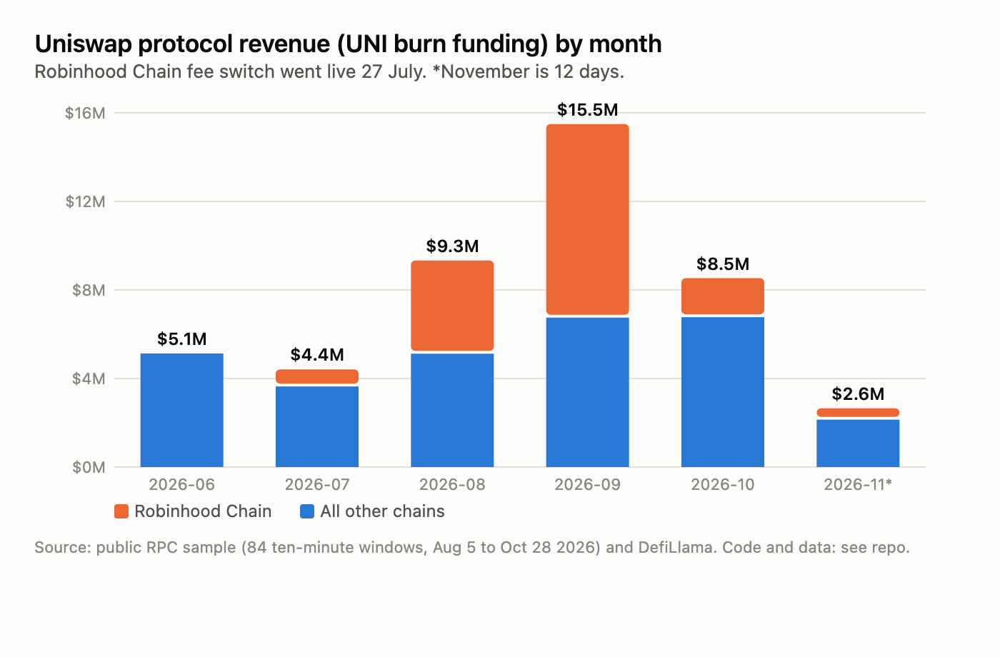
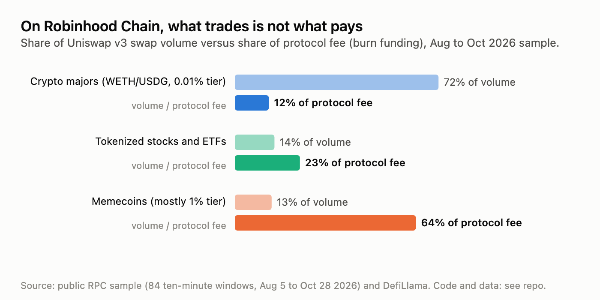
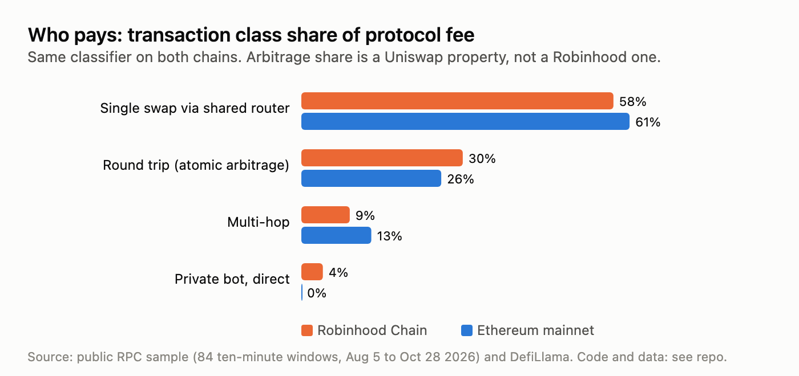
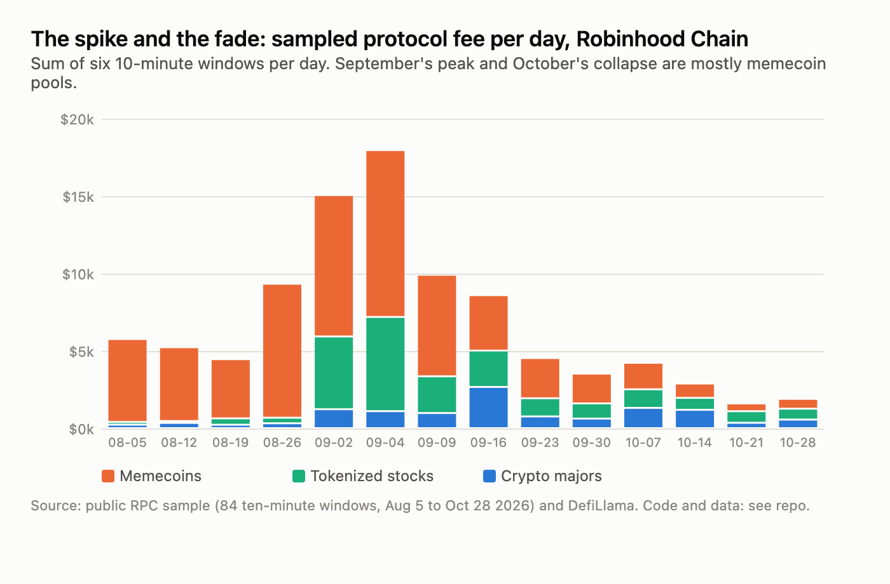

# What kind of trading funds the UNI burn, and is it durable?

*0xCadeZ, November 2026. All numbers are from public RPC endpoints (Robinhood Chain, Ethereum) and the DefiLlama fees API; code, derived data and charts are open at https://github.com/0xCadeZ/uni-burn-flow and regenerate in about 30 minutes with no API keys. Disclosure: I hold no UNI and no position on Robinhood Chain; this is posted for criticism.*

## tl;dr

Uniswap's fee switch burned about $8M of UNI a month this autumn, and from August the largest single source was Robinhood Chain. I sampled 1.19M Uniswap v3 swaps there and classified every transaction. The burn was funded 64% by memecoin pools at the 1% fee tier, 23% by tokenized stocks, 12% by WETH/USDG despite its 72% of volume. Atomic arbitrage paid 30% of it, almost the same as the 26% on Ethereum mainnet with the same classifier, so the bot share is a property of Uniswap v3, not of the chain. September's record and October's 45% drop are the memecoin line; extrapolating the September burn rate extrapolates a memecoin cycle on one chain.

**Question.** What kind of trading produced Robinhood Chain's Uniswap protocol revenue, who paid it, and how much of it should be expected to persist?

**Data.** Monthly revenue by chain from DefiLlama (reconciles to tokenbuybacks.app's reported burn within 0.3%). On Robinhood Chain, every Uniswap v3 Swap event in 84 ten-minute windows across 14 days from Aug 5 to Oct 28, 1,185,619 swaps in 449,704 pools, pulled from the public RPC. Each transaction is classified by structure (round trip, multi-hop, private bot, shared router) and each pool by what it trades (tokenized stock per Robinhood's own asset registry, crypto major, or other). The sampled protocol fees scale to $15.0M for August to October against DefiLlama's $14.7M for Robinhood v3, a 2% gap. The same classifier was run on Ethereum mainnet for two of the days as a baseline.

## 1. Where the burn money comes from

Uniswap governance activated protocol fees on v2/v3 pools in late 2025 and extended them to Robinhood Chain in July 2026 (Proposal 100 and the Robinhood expansion vote). Fees flow into TokenJar contracts that burn UNI. DefiLlama's chain breakdown gives the monthly picture: Robinhood Chain went from zero to 56% of all Uniswap protocol revenue in September, then to 21% in October. Total protocol revenue fell from $15.5M in September to $8.5M in October; the November run-rate is around $6.6M.

Several write-ups, including a bank research note, used the September rate as a run-rate. This post asks what that revenue was made of.

## 2. Method

Everything comes from public endpoints, no accounts, no paid data.

- **Burn funding by chain and month**: DefiLlama fees API, revenue breakdown by chain and version. Its 30-day figure reconciles to tokenbuybacks.app's reported burn within 0.3%.
- **Pools**: all 449,704 Uniswap v3 pools on Robinhood Chain from the factory's PoolCreated events (the count itself is a tell: a launchpad).
- **Swaps**: every v3 Swap event in 84 ten-minute windows, six per day, on 14 days from Aug 5 to Oct 28. 1,185,619 swaps. The public RPC caps each request at 10k events, so sampling is forced; the sample days bracket the peak (Sep 2, 4, 9) and the fade.
- **Pricing**: the USDG leg at $1, or the WETH leg at the window's median WETH/USDG price from the 0.01% pool. 99% of swaps priced.
- **Protocol take**: the UNIfication v3 schedule, 1/4 of the LP fee on the 0.01% and 0.05% tiers, 1/6 on 0.30% and 1%. DefiLlama's observed 26% average take for Robinhood is consistent.
- **Classification per transaction**:
  - *round trip*: two or more swaps where some token is both sold and bought within the transaction (atomic arbitrage);
  - *multi-hop*: two or more swaps, no round trip;
  - *private bot*: a single swap whose sender contract is called by at most three distinct EOAs in a 15-transaction sample;
  - *via router*: a single swap through a contract used by many distinct EOAs (SwapRouter02, aggregators, the app path).
- **Category per pool**: tokenized stock if either token is in Robinhood's own asset registry (203 tokens, api.robinhood.com/rhj/assets); crypto if both tokens are majors (WETH, USDG, stables); everything else memecoin.
- **Scale check**: sampled protocol fees scale to $15.0M for Aug-Oct against DefiLlama's $14.7M for Robinhood v3 (+2%).

## 3. What trades is not what pays

WETH/USDG is 72% of sampled volume and 12% of protocol fees. Memecoin pools, mostly X/WETH at the 1% tier, are 13% of volume and 64% of fees. Tokenized stocks, the chain's stated purpose, are 14% of volume and 23% of fees. The fee tier does the work: a dollar of memecoin volume pays 100 times what a dollar of WETH/USDG volume pays.

## 4. The arbitrage share is Uniswap's, not Robinhood's

| Class | Robinhood Chain | Ethereum mainnet (2 days) |
|---|---|---|
| Single swap via shared router | 58% | 61% |
| Round trip (atomic arbitrage) | 30% | 26% |
| Multi-hop | 9% | 13% |
| Private bot, direct | 4% | 0% |

The class mix is nearly the same on both chains. Atomic arbitrage is a quarter to a third of burn funding wherever Uniswap v3 runs; this is consistent with the older estimate that about 40% of v3 volume is arbitrage once non-atomic (CEX-DEX) flow is included, which my round-trip test does not catch. Mainnet's burn funding comes 73% from blue-chip pairs; Robinhood's came 64% from memecoins. The durability difference is in the asset mix, not in the bot share.

Inside tokenized stocks the picture is different: 137k of 256k stock swaps were round trips, and they paid 40% of stock-pool protocol fees. A stock that trades on-chain at 3am against a closed Nasdaq is a natural arbitrage target, and the bots are there.

## 5. The spike was a memecoin cycle

Per sampled day, memecoin fees were 24% of the three-month total in August, 36% in September and 4% in October. Tokenized stocks went 1%, 19%, 4%. Crypto majors 1%, 8%, 4%. The Sep 4 sample day alone was 19% of all sampled fees; Oct 21 and Oct 28 were 2% each. Robinhood Chain's monthly revenue fell 80% from September to October, and total burn revenue fell 45%.

## 6. What this suggests

1. **Durability.** A burn rate measured at the September peak is mostly a measurement of a memecoin launch cycle on one chain, taxed at the 1% tier. The components with less variance in this sample, mainnet blue-chip pairs plus tokenized stocks on Robinhood, were running at roughly a quarter of the peak by late October. I do not draw a valuation conclusion from this; I note that any extrapolation from September should say which component it is extrapolating.
2. **Protocol fee design.** The protocol fee discount auctions target "sophisticated flow." In this sample, atomic arbitrage is 30% of burn funding on Robinhood Chain and 40% within tokenized-stock pools. That is the order of magnitude a discount policy would be acting on.
3. **A new arbitrage setting.** Tokenized equities trading 24/7 on-chain against an off-chain market that is closed two-thirds of the time is, as far as I can find, unmeasured. The round-trip share here is a first number. The non-atomic component (app-to-DEX and CEX-to-DEX arbitrage, which lands in my router class) is the obvious next study, and the one I would propose to do properly: tx-level attribution with sender clustering, full-period coverage rather than sampling, and the off-market-hours split.

## Numbers at a glance

| Measurement | Value |
|---|---|
| Uniswap protocol revenue, Sep 2026 / Oct 2026 | $15.5M / $8.5M (-45%) |
| Robinhood Chain share of protocol revenue, Sep / Oct | 56% / 21% |
| Robinhood Chain v3 revenue, Aug-Oct, DefiLlama vs this sample scaled | $14.7M vs $15.0M (+2%) |
| Swaps sampled on Robinhood Chain (84 windows, 14 days) | 1,185,619 in 449,704 pools |
| Protocol fee share: memecoin / tokenized stock / crypto majors | 64% / 23% / 12% |
| Volume share of the same three | 13% / 14% / 72% |
| Protocol fee share: round trip / multi-hop / private bot / shared router | 30% / 9% / 4% / 58% |
| Same four classes on Ethereum mainnet (2 days) | 26% / 13% / 0% / 61% |
| Round-trip share of protocol fee inside tokenized-stock pools | 40% |
| Memecoin share of sampled fees by month, Aug / Sep / Oct | 24% / 36% / 4% (of the 3-month total) |

## Limitations

- 14 of 92 days, one hour per day. Weekday and intraday coverage is partial; the scale check passes but day-level numbers are noisy.
- The router class mixes retail, the Robinhood app path, aggregators and any bot that routes through them; 30% arbitrage is a floor.
- Round trips catch atomic arbitrage only. Non-atomic arbitrage lands in the router class.
- Tokens not in the Robinhood registry and not majors default to memecoin. Top pairs were checked by hand.
- The mainnet baseline is two days and reads ~45% below DefiLlama's 90-day daily average for Ethereum v3; both sampled days were calm. Shares, not levels, are the comparison.
- Protocol take is assumed from the governance schedule, not read per pool.

## References

[1] Non-Atomic Arbitrage in Decentralized Finance. Heimbach, Pahari, Schertenleib (2024). Arbitrage ~40% of Uniswap v3 volume, mostly non-atomic.
[2] Measuring CEX-DEX Extracted Value and Searcher Profitability: The Darkest of the MEV Dark Forest. arXiv 2507.13023 (AFT 2025).
[3] Cross-Rollup MEV: Non-Atomic Arbitrage on Layer-2 Blockchains. Gorzny et al., CAAW 2026.
[4] To Wait or To Probe: Arbitrage Competition on High-Throughput Blockchains. Wu, Öz (this forum, June 2026).
[5] Who actually captures MEV on Base after Flashblocks: one week of measurements. Luzin (this forum, November 2026).
[6] Uniswap governance: UNIfication; Proposal 100 (v4 protocol fees, July 2026); Protocol Fee Expansion: Robinhood Chain (July 2026).
[7] Uniswap developer docs, Fees: v3 protocol fee schedule by tier.

## Reproduce, and data offer

Repo: https://github.com/0xCadeZ/uni-burn-flow. `scripts/01_fee_series.py` (DefiLlama), `scripts/02_sample_swaps.py` (RPC sampler), `scripts/03_classify.py`, `scripts/04_mainnet_baseline.py`, `scripts/05_charts.py`. The per-window, per-pair, per-class aggregate that every number above derives from is in the repo (`data/robinhood_window_pair_class.csv`). The raw sample, 1.19M swaps with tx hash, pool, sender, recipient, amounts and sqrtPrice (~400 MB), regenerates in 30 minutes or I can share it directly. Questions, corrections and requests for other cuts are welcome; I would rather be corrected here than cited wrongly elsewhere.
